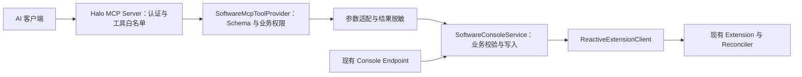

**软件中心接入 Halo MCP Server：完整实现方案**

日期：2026-10-15。状态：已按本方案完成 1.1.0 实现与本地验收；实际使用契约见 [dev/mcp.md](../dev/mcp.md)，验证范围见 [1.1.0 发布说明](release-notes-v1.1.0.md)。

后续 1.2.0 在此基础上增加创建请求持久化、业务内容前置条件和发布/删除预检查，见 [1.2.0 发布说明](release-notes-v1.2.0.md)。下文的 34 + 2 工具数与实施决策保留为 1.1.0 设计记录；当前目录为 43 + 2。

本方案依据 `plugin-software` 当前提交 `eca3fd6`、Halo MCP Server 官方接入说明、MCP API 正式版 `1.0.0` 的已发布源码，以及 Halo `v2.26.0` 的 Extension 客户端实现制定。保留工作区原有发布说明，另增 1.1.0 发布说明。本文保留设计依据，代码结构表已更新为实际实现。

**方案采用可选 Provider 集成，在现有业务服务之上增加 MCP 入口。**

软件中心贡献工具，由 Halo MCP Server 处理协议、连接、密钥和工具目录。实现放在现有插件内，不新增独立服务，不让 MCP 通过 HTTP 绕回 Console API。官方支持通过编译期 API 和可选插件依赖实现这种集成。[官方 Provider 接入指南](https://github.com/halo-dev/plugin-mcp-server/blob/main/dev/dev.md)



交付范围是软件、版本、下载源、分类、标签、专题的管理，以及选项、统计查询。基础组 34 个工具；敏感下载配置另有 2 个工具，默认关闭，总计 36 个。管理员通过访问密钥选择实际开放的工具，不要求每个客户端加载全部工具。

这套工具面向站点管理，可以读取草稿和未发布内容。公开访客仍使用现有 Public API / Finder。工具不提供任意 Extension 操作、任意 Secret 读取、任意 URL 请求、远程程序执行、软件安装或批量级联删除。

现有 AI Foundation 编辑辅助继续独立工作。AI 客户端自身可以生成文案，再调用软件创建、更新工具；基础 MCP 功能不需要 AI Foundation。

**先固定版本与可选加载契约，避免开发分支 API 混入正式版。**

| 项目 | 实施前基线 | 已采用决策 |
| --- | --- | --- |
| 软件插件版本 | `1.0.0` | 本地构建版本为 `1.1.0`，尚未执行远程发布 |
| Java | 21 | 保持 21 |
| Halo BOM | `2.25.0` | 升级为 `2.26.0` |
| DevTools Halo 实例 | `2.25` | 使用 `2.26.0` 基线联调，并验证实际部署版本 |
| 插件最低 Halo 版本 | `>=2.25.0` | 本次新版本明确提升到 `>=2.26.0` |
| MCP API | 无 | 固定 `run.halo.mcpserver:api:1.0.0` |
| MCP 插件依赖 | 无 | 可选依赖 `mcp-server?: ">=1.0.0 & <2.0.0"` |
| AI Foundation | 已有可选依赖 | 保留，MCP 核心不引用其 API |
| UI 工具链 | Vite、pnpm 10、Halo UI 2.25 系列 | 本次保留锁文件及现有输出格式，验证其在 Halo 2.26 中加载 |

最低运行版本来自 MCP Server 自身的插件清单。把新版本软件中心也提升到 2.26，是本方案明确选择的维护策略；不是声称“可选依赖本身强制所有 Provider 升级”。仍在 Halo 2.25 上的站点继续使用旧版本软件中心。[MCP Server 清单](https://github.com/halo-dev/plugin-mcp-server/blob/v1.0.0/src/main/resources/plugin.yaml)

构建依赖：

```groovy
dependencies {
    implementation platform('run.halo.tools.platform:plugin:2.26.0')
    compileOnly 'run.halo.mcpserver:api:1.0.0'
    testCompileOnly 'run.halo.mcpserver:api:1.0.0'
    testRuntimeOnly 'run.halo.mcpserver:api:1.0.0'
    // 保留当前其他依赖。
}
```

```yaml
spec:
  requires: ">=2.26.0"
  pluginDependencies:
    ai-foundation?: ">=1.0.0-SNAPSHOT & <2.0.0"
    mcp-server?: ">=1.0.0 & <2.0.0"
```

API `1.0.0` 已核验可以从 Maven Central 获取。本次检查发现：该正式版的 `McpToolDefinition.Builder` 没有当前主分支新增的 `category()`。实现仅使用正式版已有方法；工具的业务分组先体现在中文标题、说明及文档中。[正式版源码制品](https://repo.maven.apache.org/maven2/run/halo/mcpserver/api/1.0.0/api-1.0.0-sources.jar)

注册遵循官方条件配置模式：

```java
@Configuration
@ConditionalOnClass(name = "run.halo.mcpserver.api.McpToolProvider")
public class SoftwareMcpConfiguration {
    @Bean
    SoftwareMcpToolProvider softwareMcpToolProvider(
        SoftwareConsoleService service,
        ReactiveSettingFetcher settings) {
        return new SoftwareMcpToolProvider(service, settings);
    }
}
```

当前实现使用上述装配边界。Provider 不添加 `@Component`；MCP 专属辅助类统一在此条件配置下装配。现有插件入口、业务服务、Finder 和 Reconciler 不引用 MCP API 类型。不把 API 或 MCP Java SDK 打进软件插件 JAR。

`tools()` 仅读取必要的 MCP 开关并返回预先构建的工具定义，不查询软件库、不执行 AI 请求。开关变化在下一次目录解析或调用时生效；权限回调再次读取开关，处理工具列表读取后配置发生变化的情况。未安装、禁用或卸载 MCP Server 时，软件管理应继续可用。

所有 Handler 返回完整 Mono 链，不调用 block()，不自行 subscribe()，不引入用于维持工具注册的后台线程。取消信号向业务服务传播；不跨调用缓存资源对象或认证上下文。工具定义可以复用，单次请求的参数、权限与结果不能复用。

**按业务动作定义工具，避免通用工具扩大密钥授权范围。**

下表是完整工具目录。Provider 只声明本地名称，例如 `list_apps`；MCP Server 根据插件 ID `software` 生成 `software__list_apps`。前缀不由软件插件手工拼接。所有工具都定义对象类型的输入 Schema、成功输出 Schema、权限回调和 Handler。

| 工具组 | 本地工具名 | 数量 | 行为与关键约束 |
| --- | --- | ---: | --- |
| 基础信息 | `get_options`, `get_stats` | 2 | 返回业务选项，以及软件、下载源统计；不返回完整 ConfigMap |
| 软件 | `list_apps`, `get_app`, `create_app`, `update_app`, `set_app_published`, `delete_app` | 6 | 创建默认草稿；普通创建、更新不能带 `published` 或 `publishedAt`；发布状态走独立工具 |
| 版本 | `list_versions`, `get_version`, `create_version`, `update_version`, `delete_version` | 5 | 创建默认 `draft`；支持 `draft/released/beta/deprecated`；禁止把已有版本迁移到另一软件 |
| 下载源 | `list_download_assets`, `get_download_asset`, `create_download_asset`, `update_download_asset`, `delete_download_asset` | 5 | 普通工具仅操作非敏感配置；创建默认禁用；禁止修改已有下载源的 appName/versionName 归属 |
| 分类 | `list_categories`, `get_category`, `create_category`, `update_category`, `delete_category` | 5 | 支持树形归属、可见性和排序，保留循环引用检查 |
| 标签 | `list_tags`, `get_tag`, `create_tag`, `update_tag`, `delete_tag` | 5 | 支持颜色、可见性、排序与使用状态筛选 |
| 专题 | `list_topics`, `get_topic`, `create_topic`, `update_topic`, `set_topic_published`, `delete_topic` | 6 | 创建默认草稿，条目列表整体替换，发布独立授权 |
| 敏感下载配置 | `get_download_asset_secrets`, `update_download_asset_secrets` | 2 | 独立开关、独立工具白名单；读取与写入分开授权 |
| 合计 | 基础 34 个，敏感 2 个 | 36 | 不包含未来 AI 异步工具 |

管理权限不能称为“仅编辑草稿”：`update_app` 可以修改已经发布的软件，版本状态和下载源启用状态也可能影响前台。独立发布工具只隔离发布状态切换，不实现内容审批流程。工具说明必须清楚表达这种影响。

工具注解使用正式版 `McpToolAnnotations`：查询为只读；创建为非只读、非破坏性、非幂等；更新、发布和删除保守标记为有修改风险，`idempotentHint=false`。版本前置条件意味着重复调用可能产生冲突，因此不虚称严格幂等。基础工具不主动访问外部站点，`openWorldHint=false`。这些注解是客户端提示，不能替代实际授权。

**查询契约使用通用条件对象，与 HTTP 请求解耦。**

当前 `SoftwareConsoleQuery` 的构造参数是 `ServerWebExchange`，不能直接作为 MCP 参数对象。新增 `SoftwareListCriteria` 和查询构造器，提取现有过滤、排序、分页逻辑。现有 Console 入口把 HTTP 参数转换为该对象；MCP 入口把 JSON 参数转换为同一对象。保留 Console 原有参数、默认行为和 label/field selector 支持，MCP 只接受下表的明确筛选字段。

`get_*` 统一接受资源 `name`，始终表示 `metadata.name`。它不是公开 URL 的 slug，也不是版本显示字符串。通过 `list_*` 的精确 slug 或所属资源过滤先定位 name，避免将两种标识混用。

| 列表工具 | 允许的业务筛选参数 |
| --- | --- |
| `list_apps` | `keyword`, `slug`, `published`, `categoryName`, `tagName`, `platform`, `featured`, `recommended` |
| `list_versions` | `keyword`, `appName`, `version`, `status` |
| `list_download_assets` | `keyword`, `appName`, `versionName`, `type`, `provider`, `enabled`, `protection` |
| `list_categories` | `keyword`, `slug`, `parentName`, `visible` |
| `list_tags` | `keyword`, `slug`, `visible`, `usage` |
| `list_topics` | `keyword`, `slug`, `published`, `featured` |

精确 `slug`、`version` 等条件通过已有索引构建，不退化为内存全量过滤。`protection` 第一版只支持现有 `protected`；`usage` 支持 `used/unused`。未设置筛选参数表示不限制。分类根节点筛选如需新增单独的 `rootOnly`，应作为后续明确契约扩展，不把空字符串偷偷解释为根节点。

公共分页参数：`page` 默认 1，必须为正整数；`size` 默认 20，范围 1–100；`keyword` 最长 200 字符。MCP 不开放原始 `fieldSelector`、`labelSelector` 或任意字段排序。

排序参数使用 `sortBy` 与 `order=asc|desc`。软件允许 `createdAt/name/publishedAt/downloads`，版本允许 `createdAt/name/releaseDate`，下载源允许 `createdAt/name/priority/downloads`，分类、标签、专题允许 `createdAt/name/priority/appCount`。映射到现有索引字段；默认软件、版本按创建时间降序，下载源及分类、标签、专题按 priority 升序；都追加 name 作为稳定次序。稳定次序不意味着跨页快照一致，数据在翻页期间变化仍可能影响结果。

列表仅返回摘要，详情工具返回完整可管理字段。软件列表不带完整 description；版本列表不带 changelog/installGuide；专题列表不展开所有条目；下载源所有普通结果均不带敏感值。

成功结构统一如下：

```json
{
  "items": [
    {
      "name": "software-app-example-app",
      "resourceVersion": 7,
      "slug": "example-app",
      "displayName": "示例软件",
      "published": false
    }
  ],
  "page": 1,
  "size": 20,
  "total": 1,
  "hasNext": false
}
```

上例仅展示软件摘要的公共关键字段；各资源完整输出已按本方案字段矩阵逐项定义并测试。详情和成功写入统一返回 `{ "item": ... }`；删除返回 `{ "name": "...", "state": "deletion_requested" }`，因为 Halo 删除先设置删除时间戳，不能把请求接受描述为所有清理已完成。[Halo 2.26 Extension 删除实现](https://github.com/halo-dev/halo/blob/v2.26.0/application/src/main/java/run/halo/app/extension/ReactiveExtensionClientImpl.java)

`get_options` 返回规范化的 label/value 业务选项，不返回 UI className、AI 模型配置或安全配置。版本状态必须与服务实际支持的四个值一致，不能因为选项配置里出现任意值就宣称服务支持。`get_stats` 返回 `{ "apps": SoftwareConsoleStatsVo, "downloadAssets": DownloadAssetStatsVo }`；两部分是读取时统计，不承诺跨资源事务快照。

所有资源结果使用专用 DTO：挑选 metadata.name、metadata.version 等必要字段，不直接输出完整 metadata、annotations、labels 或原始 Extension。明确区分 `resourceVersion`（并发控制版本）与软件版本的 `version`（如 `1.2.0`）。状态和统计来自现有 Reconciler，可能晚于写入结果；不在工具内重复递增计数。

**写入采用字段白名单、明确的清空语义和版本前置条件。**

创建输入使用 `{ "spec": {...} }`。普通更新使用 `{ "name": "...", "expectedVersion": 7, "patch": {...}, "clearFields": [...] }`。删除使用 `{ "name": "...", "expectedVersion": 7 }`。发布工具额外要求 `published: boolean`。`expectedVersion` 是非负整数，从最近一次详情或写入结果的 resourceVersion 取得。

| 资源 | 创建必填字段 | 可管理字段与限制 |
| --- | --- | --- |
| 软件 | `slug`, `displayName` | subtitle、vendor、officialWebsite、icon、cover、screenshots、summary、description、categoryName、tagNames、platforms、licenseType、releaseChannel、locale、architectures、editorRating、featured、recommended、seo、relatedAppNames、relatedPostNames；只读兼容旧 platform，不接受新写入；published/publishedAt 由发布操作管理 |
| 版本 | `appName`, `version` | build、releaseDate、sizeBytes、minOsVersion、maxOsVersion、architectures、locale、changelog、installGuide、installWarnings、checksum、status；更新不接受 appName |
| 下载源 | `appName`, `versionName`, `title` | type、provider、requiresLogin、requiresCaptcha、region、priority、enabled；更新不接受 appName/versionName，也不接受任何敏感字段 |
| 分类 | `slug`, `displayName` | parentName、description、icon、priority、visible、seo |
| 标签 | `slug`, `displayName` | description、color、priority、visible、seo |
| 专题 | `slug`, `title` | subtitle、description、cover、items、featured、priority、seo；published 由发布操作管理 |
| 敏感下载配置 | 更新需 name、expectedVersion 与至少一项变更 | 仅 url、storageKey、extractionCode、passwordSecretName，独立 DTO 与 Schema |

slug 使用现有 `[a-z0-9]+(?:-[a-z0-9]+)*` 规则。日期使用 ISO 日期，数量与 priority 等沿用业务校验，SHA-256/MD5、标签颜色、父子分类循环、关联资源存在性及所属软件关系继续由业务层检查。平台、架构、来源等可配置选项通过 `get_options` 提供，除已有硬性业务枚举外，不擅自把自定义值改成固定枚举。

创建和更新的 JSON Schema 使用 `additionalProperties:false`，嵌套对象同样约束。拒绝 metadata、顶层 status、apiVersion、kind 等系统字段。这里“顶层 status”与合法的 `SoftwareVersion.spec.status` 不同。表中未列出的可选系统信息只读。

当前更新方法通过忽略 null 的方式合并，无法表达清空。本次新增存在感知的 patch 路径，并保持原 Console PATCH 语义不变：

- 字段未出现：保留原值；显式 null：拒绝，提示使用 clearFields。
- `false`、`0`、`[]` 都是有效更新值，不当作缺省。
- 字符串、关联引用或嵌套可选字段需要清空时，通过 clearFields 明确指定，例如 `categoryName`、`seo.description`、`checksum.md5`。
- clearFields 只接受本工具可写且允许为空的字段；不能清空必填、归属、发布状态、布尔值或带默认值的计数字段。
- 数组整体替换，可用 `[]` 清空；清空可选数组也规范化为 `[]`。嵌套对象逐字段合并，不能更新 SEO title 时顺带清掉 keywords。
- 同一字段或相互覆盖的父子路径同时出现在 patch 和 clearFields 中，返回 INVALID_ARGUMENT。
- patch 和 clearFields 都无内容时返回 INVALID_ARGUMENT。

实现将 MCP 请求映射为不依赖 MCP API 的领域修改对象。业务服务在一次读取到的资源上完成：版本检查、合并、清空、归一化、引用校验，再把同一资源及其版本提交给 client.update/delete。禁止 Provider 先检查版本，再调用一个重新读取并覆盖版本的旧方法，否则存在检查与写入分离的问题。

Halo 的存储更新带版本参数，可处理读取后发生的竞争更新。客户端版本过期返回 CONFLICT，不自动重试覆盖别人的修改。Reconciler 更新状态也可能使 resourceVersion 改变，此时读取新版本并重新评估即可。旧 Console 方法通过无前置条件的入口复用公共校验，不强制改变现有 HTTP 参数。[Halo 2.26 更新与存储调用](https://github.com/halo-dev/halo/blob/v2.26.0/application/src/main/java/run/halo/app/extension/ReactiveExtensionClientImpl.java)

写入示例：

```json
{
  "name": "software-app-example-app",
  "expectedVersion": 7,
  "patch": {
    "summary": "更新后的软件简介",
    "platforms": ["macOS", "Windows"],
    "recommended": true
  },
  "clearFields": ["seo.description"]
}
```

发布默认沿用现有语义：首次发布设置 publishedAt；取消发布后再次发布保留既有时间。工具不新增必须存在下载源才能发布的限制，以免改变现有产品规则。

删除继续保留已有引用检查：软件存在版本或下载源、版本存在下载源、分类存在子分类或被软件引用、标签被软件引用时拒绝删除。专题删除不删除其软件。软件删除不会自动改写专题 items 或 relatedAppNames；公开查询过滤不存在的软件，Reconciler 重新计算有效数量。跨资源引用检查不具备全库事务保证；并发创建关联对象时的完整一致性属于现有领域能力边界。

创建不宣称 exactly-once。保留现有 slug / appName+version 重复检查，但这些检查不是分布式唯一约束。下载源名称自动生成，重试创建可能重复，因此创建和更新都不做隐式网络重试。请求结果不明时先查询核实。持久化幂等键和多资源事务不纳入此次 MCP 适配。

**下载敏感配置保留独立入口，并修正直接复用时的风险。**

当前普通下载源接口使用 DownloadAssetCommand 限制写入字段，使用 DownloadAssetConsoleVo 去除敏感返回字段；这些处理位于 Endpoint，不能假设业务服务自动完成。MCP 普通下载源创建、读取、更新、删除结果都经过同样的字段挑选，再转为 MCP DTO。

普通工具只返回 `hasUrl/hasStorageKey/hasExtractionCode/hasPasswordSecret` 等存在性信息，不返回实际值。敏感字段黑名单也适用于嵌套对象、异常文本、textContent、调试日志和完整 metadata。

新增设置组 `mcp`：

| 设置 | 默认值 | 含义 |
| --- | --- | --- |
| `enabled` | true | MCP Server 存在时贡献基础工具；实际访问仍需密钥授权 |
| `exposeSensitiveTools` | false | 是否贡献敏感读写两个工具；开启后仍需分别加入密钥白名单 |

设置组不存在时使用默认值；配置读取异常时不贡献工具并拒绝调用，记录不含敏感数据的诊断，不影响软件中心其他功能。没有单独的“允许所有写入”开关，细粒度授权统一使用 MCP Server 工具白名单。

`get_download_asset_secrets` 仅返回该 DownloadAsset 自身保存的 url、storageKey、extractionCode、passwordSecretName 和 resourceVersion；不解析或返回 Halo Secret.data。`update_download_asset_secrets` 允许更新这四个字段，成功结果只返回脱敏后的 DownloadAsset 摘要及新版本，不回显传入的敏感内容。

现有 updateDownloadAssetSecret 是整体替换：四项未传值可能被清空。因此不能把 MCP patch 直接转换为旧 Command 后提交。新增领域 patch 方法：读取现值、检查版本、按字段合并/清空，再执行现有目标 URL 策略和 Secret 引用校验。不能以“先读 Secret VO、再调用会重新读资源的旧方法”实现，否则并发条件不成立。

普通下载源完整配置顺序：先创建禁用的源，再通过专用敏感工具或 Console 配置目标，最后通过普通更新启用。已启用源清空最后一个可用目标应失败；禁用后允许清空。修改 requiresLogin/requiresCaptcha 是有实际访问影响的管理操作，工具描述必须说明。

MCP 不提供跳过登录或验证码的下载授权工具，不将服务端管理认证当成访客下载授权；现有 `download-grants` 路径保持原语义。敏感工具读权限意味着该客户端会看到下载配置，这是明确授权结果，不应被包装成普通查看权限。

**权限采用 MCP 密钥能力授权，软件领域继续自行约束。**

MCP Server 先检查所调用工具是否在当前密钥白名单中，再执行 Provider permission。其正式版认证主体使用超级管理员角色，不能据此推导普通 Console 用户角色已经完成映射。Provider API 的 invocation 只有 toolName 与 arguments，不能虚构从中获取 keyId 的方法，也不依赖 MCP 插件内部认证类。[正式版认证实现](https://github.com/halo-dev/plugin-mcp-server/blob/v1.0.0/src/main/java/run/halo/mcpserver/McpKeyAuthenticationToken.java)

基础 permission 回调检查响应式安全上下文中的认证状态及 mcp.enabled；敏感工具额外检查 exposeSensitiveTools。HTTP RoleTemplate 继续服务 Console，不新增匿名角色、不授予访问原始 Extension 或任意 Secret 的能力。安全边界由工具白名单、参数白名单、结果 DTO 和领域校验共同形成。

建议在使用文档中提供工具选择模板，而不是实现另一套密钥管理：

| 密钥用途 | 建议选择 |
| --- | --- |
| 查看与分析 | 基础组的 list/get/options/stats；仍可看到草稿 |
| 内容维护 | 查看工具加需要的 create/update；会影响已发布内容 |
| 发布操作 | 必要查询工具加 set_app_published / set_topic_published |
| 清理维护 | 必要查询工具加指定 delete，不默认包含敏感读写 |
| 下载配置写入 | 必要普通查询加 update_download_asset_secrets，可不授予敏感读取 |
| 下载配置排查 | 额外选择 get_download_asset_secrets |

所有新工具仍由管理员显式加入密钥。说明 annotations 只是风险提示，不实现强制确认；本次不增加伪安全的 `confirm=true` 参数。

**错误、超时和结果大小形成可预测的工具契约。**

新增不依赖 MCP 的 SoftwareDomainException / reason，MCP ErrorMapper 按类型或 reason 转换。重复 slug、重复版本、被引用等现有 HTTP 400 行为可保留，由类型标识区分 MCP 语义，不通过匹配英文异常消息判断。

| 稳定错误码 | 场景 | 客户端处理 |
| --- | --- | --- |
| `INVALID_ARGUMENT` | Schema、格式、非法状态、范围、不可清空字段 | 修正参数 |
| `NOT_FOUND` | 操作目标不存在 | 重新查询 |
| `ALREADY_EXISTS` | slug 或软件版本重复 | 读取现有对象，按意图决定是否更新 |
| `REFERENCE_INVALID` | 引用不存在、所属软件不匹配、分类循环 | 修正关联 |
| `RESOURCE_IN_USE` | 已有引用阻止删除 | 先处理关联关系 |
| `CONFLICT` | expectedVersion 不匹配或存储乐观锁冲突 | 重新读取、重新评估，禁止静默覆盖 |
| `FORBIDDEN` | 开关关闭、未认证或工具未获授权 | 管理员调整配置/授权 |
| `TIMEOUT` | 只读查询超时 | 缩小范围后重试 |
| `WRITE_OUTCOME_UNKNOWN` | 写入链路超时，无法确认是否提交 | 查询目标状态，禁止直接重试创建 |
| `RESULT_TOO_LARGE` | 只读详情超过工具响应大小上限 | 提示使用 Console 读取完整内容 |
| `INTERNAL` | 未预期故障 | 返回诊断 ID，不暴露堆栈、Token 或敏感值 |

预期失败通过 `McpToolResult.error(code, message)` 返回；成功内容通过 success 工厂返回。只给成功结果声明 outputSchema，错误遵循 API 原生 `{error:{code,message}}` 结构。前置白名单拒绝和 Server 自身故障由 Server 返回，不能声称所有错误都受 Provider 自定义映射控制。

MCP Server `v1.0.0` 的工具目录及 Provider 回调默认预算为 5 秒，包含 Handler 返回的 Mono。基础 Handler 采用约 4 秒的自身预算，争取在 Server 超时前返回明确错误；permission 仅做轻量检查。超时/取消不等同于数据库回滚，尤其不能对已可能落库的写入承诺失败无副作用。[正式版 Provider 回调实现](https://github.com/halo-dev/plugin-mcp-server/blob/v1.0.0/src/main/java/run/halo/mcpserver/McpToolRegistry.java)

建议 MCP 边界初始限制：单次输入序列化后不超过 256 KiB；普通短字符串不超过 2048 字符，显示名称和标题不超过 200；长文本不超过 100000 字符；普通数组最多 100 项；专题条目最多 200 项；短字段的 slug/name 上限设为 253 字符，并同时满足底层规则。这些是新 MCP 输入约束，不反向缩减现有 Console 数据。Schema 与 Handler 共用常量，避免定义和执行不一致。

返回体目标上限 512 KiB。列表摘要中的文本以最多 200 字符显示，明确返回截断标记；摘要不用于全量覆盖更新。只读详情超限明确报错，不悄悄截断为“完整详情”。写操作成功后若完整表示过大，返回包含 name、resourceVersion、changedFields 的成功回执及 `representationOmitted:true`，不能把已落库写入改报为失败。outputSchema 必须包含两种成功表示。

工具结果携带的 description、changelog 等内容是站点数据，工具描述明确其为非指令内容。Markdown/HTML 原文不在日志中展开。保持现有公共 VO 对软件 description 的 HTML 净化；MCP 管理详情为编辑而返回原文时，明确标注为内容数据，不能当成已净化的浏览器 HTML。工具本身不执行 HTML、脚本或出站请求。

基础统计继续复用现有流式统计服务，不新增统计缓存或 Extension；数据量较大时可能超时，应返回 TIMEOUT。性能验收使用带数据量说明的固定测试集，目标普通读写在 4 秒内部预算内完成；不承诺任意数据规模下的固定 SLA。

**AI 编辑建议保留扩展位置，本次不直接暴露同步生成工具。**

现有 SoftwareAiService 会请求远端模型，完整生成可能超过 5 秒。给 Handler 内部加 60 秒 timeout 不能覆盖 MCP Server 外层的 5 秒限制。因此本次 36 个工具不包含同步 `suggest_app`，也不在 create/update 中隐式触发 AI 请求。

将来若需要复用站点配置的 AI Foundation，单独实现异步作业：`start_app_suggestion` 快速返回 taskId，`get_app_suggestion` 查询 queued/running/succeeded/failed，必要时提供取消；作业需有持久化状态、过期策略、并发上限和插件停用处理。结果只给建议，不自动保存或发布。也可在上游新增可配置超时并发布后重新评估同步方式。异步作业不是完成基础 MCP 集成的前置条件。

**代码变更集中在适配层与少量可复用的领域入口。**

| 路径 | 实际修改内容 |
| --- | --- |
| `build.gradle`、`gradle.properties` | Halo/API 依赖、开发版本、发布版本；测试类路径；不打包 MCP API |
| `src/main/resources/plugin.yaml` | Halo 最低版本和 MCP 可选依赖 |
| `src/main/resources/extensions/settings.yaml` | 新增 mcp.enabled、exposeSensitiveTools 设置 |
| `SoftwareConsoleQuery.java` | 保留 HTTP 参数接口，委托通用查询构造器 |
| `finders/SoftwareConsoleService.java` 与实现 | 新增封闭资源集合的 list/get/create/patch/delete 入口；版本前置条件、明确 patch/clear、发布和敏感字段模式；显式补充 MetadataOperator 的 Jackson 3 具体类型映射 |
| `query/SoftwareListCriteria.java` | HTTP 无关条件和共用索引查询构造；MCP 的白名单排序在 Provider/Schema 中 |
| `api/SoftwareMutation.java`、`api/SoftwareResourceKind.java` | expectedVersion、字段白名单、封闭资源类型和 clearFields；不引用 MCP API |
| `SoftwareDomainException.java` | 业务失败 reason，保留 HTTP 兼容 |
| `mcp/SoftwareMcpConfiguration.java` | 条件装配，避免可选依赖缺失时加载 API 类型 |
| `mcp/SoftwareMcpToolProvider.java` | 统一贡献工具、按设置过滤可选组 |
| `mcp/SoftwareMcpSchemas.java` | 正式版 API 支持的 JSON Schema、边界常量和注解 |
| `mcp/SoftwareMcpAccessPolicy.java` | 认证及开关检查 |
| `mcp/SoftwareMcpErrorMapper.java` | 领域错误与运行错误映射，脱敏诊断 |
| `mcp/SoftwareMcpResults.java` | 明确字段白名单的列表摘要、详情、写回执；不暴露原始 Extension |
| `mcp/SoftwareMcpInput.java` 与 Provider | 输入大小与 Schema 二次验证；Provider 按 SoftwareResourceKind 共用六类工具装配流程，避免复制六套实现 |
| `src/test/` | 查询兼容、patch、并发、权限、Schema、脱敏、可选加载测试 |
| `dev/mcp.md`、README、开发文档 | 工具目录、授权模板、调用示例、安装与故障说明 |

不建立一套平行 repository/service，不为每个工具单独建类，不在 Provider 中复制引用、slug、下载目标校验。get 方法补齐属于领域服务能力，Provider 不直接绕过服务访问原始 Extension。

本次不增加独立 Console 页面，使用现有插件设置与「工具 → MCP 服务」。不手工编辑 OpenAPI JSON 或生成的 TypeScript Client；如果实现使 HTTP 描述、参数或生成结果发生变化，运行 `generateApiClient` 并审查差异。纯 Java 内部适配不要求为了形式而生成客户端。

**按五个可验证里程碑实施。**

| 阶段 | 工作 | 阶段完成标准 |
| --- | --- | --- |
| 1. 基线与可选加载 | 升级 Halo 基线，加入 API 依赖、清单、条件配置；先实现 get_options | 正式版 API 可编译；未装 MCP 可启动；安装后工具可发现；JAR 无 MCP API/SDK |
| 2. 查询与结果模型 | 提取通用条件对象，补详情入口，实现 14 个只读基础工具：12 个 list/get 加 options/stats | Console 查询回归通过；分页、过滤、摘要与脱敏通过；只读密钥不能调用写入 |
| 3. 内容与发布管理 | 6 个 create、6 个 update、2 个发布、6 个 delete，共 20 个写工具；patch/clear、expectedVersion、错误码 | 基础 34 个工具完整；跨资源流程可走通；冲突与删除约束可验证 |
| 4. 敏感配置 | 两个敏感工具、默认关闭开关、独立 DTO、保留字段的敏感 patch | 关闭时不可发现/调用；开启未授权仍拒绝；只写密钥不能读取敏感值；普通结果始终脱敏 |
| 5. 发布验证与文档 | 生命周期、数据规模测试、构建、开发与使用文档、发布说明 | 验收矩阵通过；发布包可安装；说明实际测试版本与未验证范围 |

每个阶段结束保存实现和验证结果；此表是实施顺序，不创建自动发布、远程提交或部署任务。本地实现和验收已完成；远程提交、发布和站点部署属于后续发布操作。

**验收关注可观察行为，不以“构建成功”替代接入验证。**

| 验收组 | 必须覆盖的行为 |
| --- | --- |
| 正式版契约 | 以 API 1.0.0 编译；所有名称唯一且符合约束；不引用 main 独有 category 方法；所有 input/output Schema 合法 |
| 查询兼容 | 现有 Console 筛选、排序、分页、label/field selector 行为保持；MCP 页码、size、排序白名单、无结果、精确 slug、跨平台过滤正确 |
| 参数处理 | 拒绝未知字段、显式 null、非法 clearFields、非法日期与枚举；false/0/[] 正确生效；嵌套 SEO/checksum 保留未变字段 |
| 写入与引用 | 默认草稿/禁用；发布隔离；slug/版本重复；分类循环；下载源版本归属；禁止 MCP 迁移已有归属 |
| 并发 | 陈旧 expectedVersion 拒绝；检查后发生并发写入也冲突；无静默重试；敏感 patch 只修改给定字段 |
| 删除 | 被引用目标拒绝；专题删除不删除软件；删除结果标为请求已接受；既有 Reconciler 清理行为有记录 |
| 权限 | 无密钥/失效密钥失败；只读密钥不能调写工具；新工具不会自动加入既有密钥；敏感读写分别授权；全局关闭后调用拒绝 |
| 隔离 | 普通查询、创建、更新、删除的 structuredContent 和 textContent 无敏感值；原始 metadata 不泄露；未知异常与日志无敏感 payload |
| 状态组合 | MCP 不存在、已安装未启用、启用、禁用、重新启用、卸载；软件插件启停与热重载；AI Foundation 缺失不影响基础工具 |
| 大结果与超时 | 列表大小限制；摘要截断标记；详情超限；写成功的大结果使用成功回执；只读 TIMEOUT；写入超时不误报安全回滚 |
| 包与界面 | JAR 未嵌入 run/halo/mcpserver/api 或 io/modelcontextprotocol；UI 入口、样式资源完整；Console 在 Halo 2.26 正常加载 |

单元测试以 StepVerifier、服务协作与结果断言为主。Schema 测试覆盖具体有效/无效请求与返回，不只搜索源码字符串。使用隔离类加载器或 Spring 测试上下文验证缺失 MCP API 的实际加载路径，并在真实 Halo 插件环境验证生命周期；仅反射断言注解存在不算可选加载验证通过。

现有检查入口：

```bash
# 在 plugin-software 根目录执行
./gradlew test
./gradlew build

# HTTP 契约或生成描述发生变化时执行
./gradlew generateApiClient --no-daemon

# 在准备好的开发环境中验证安装与重载
./gradlew haloServer
./gradlew reloadPlugin
```

`build` 已通过 UI 子项目的 check 接入单元测试、类型检查和 lint；实施时确认 Vitest 在 CI/非交互模式退出，避免开发监听模式挂起。已有检查通过后不无理由重复全量测试。构建后额外查看 JAR 条目，不把测试类路径误认为已打包的依赖。

端到端示例流程：

1. 安装软件中心与 MCP Server；只读密钥选择需要的查询工具，验证只能看到该密钥选中的工具。
2. 管理密钥创建分类、标签、软件草稿，记录服务器生成的 name 和 resourceVersion。
3. 创建该软件的 draft 版本与禁用下载源。
4. 在 Console 配置下载目标；或者开启敏感组，给专用密钥仅授权敏感写工具并配置目标。
5. 获取最新资源版本，启用下载源、调整版本状态，再用发布工具发布软件；主题详情按既有公开规则显示。
6. 创建专题并加入该软件，单独发布专题，检查公开页面与统计最终收敛。
7. 尝试用旧 expectedVersion 修改，应返回 CONFLICT；尝试删除仍含版本的软件，应返回 RESOURCE_IN_USE。
8. 检查普通 MCP 响应没有 URL/提取码等敏感值；关闭敏感组后原敏感密钥也不可再调用。
9. 禁用、重新启用并卸载 MCP Server，软件中心的 Console、公开 API 与主题路由保持可用。

**交付与回退保持可控。**

交付物包括软件插件源码和测试、构建 JAR、`dev/mcp.md`、更新后的 README/开发文档与版本发布说明。记录实际验证的 Halo、MCP Server、JDK 和客户端版本，不把 `<2.0.0` 声明写成“已验证全部未来 1.x”。新版本提高最低 Halo 要求，发布说明必须明确。

本次不改现有 Extension GVK、不重命名数据字段、不引入业务数据迁移。关闭 mcp.enabled、撤销密钥工具授权或禁用 MCP Server 可以停用新入口；这些操作不会撤销已经成功执行的内容修改。部署前按现有发布流程保留数据库和插件包备份；如需回退插件包，应先停止 MCP 写入并核对升级期间的数据改动。

MCP Server 的最近调用记录可用于现场排错，但正式版实现是容量有限的内存记录，不应描述为持久化合规审计。软件插件仅补充不含 payload 的错误诊断，不在本次适配中建设另一套审计平台。[正式版最近调用记录实现](https://github.com/halo-dev/plugin-mcp-server/blob/v1.0.0/src/main/java/run/halo/mcpserver/McpRecentCallHistory.java)

实施前已确认的关键事实是：业务服务可复用；需要拆出 HTTP 查询对象；需补齐四类资源详情方法；现有 null 合并无法清空字段；下载敏感接口是整体替换；普通脱敏发生在 Endpoint；正式 API 缺少 main 的 category 方法；正式 Server 回调默认 5 秒。这些适配点均已实现。验证使用独立的 Halo 2.26.0 / MCP Server 1.0.0 实例，包含全部 36 个工具的真实调用、密钥白名单、敏感授权和可选插件生命周期。具体测试数量、容量样本与未验证范围记录在 1.1.0 发布说明。
